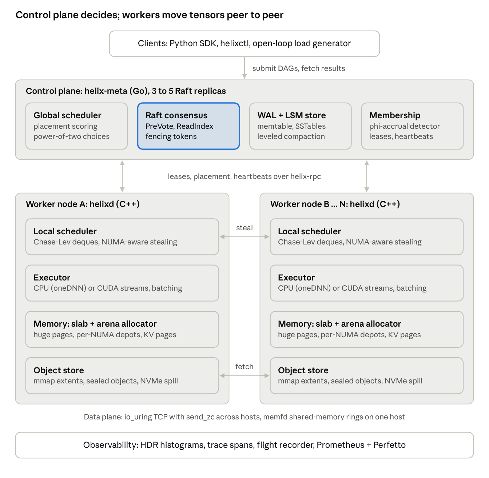
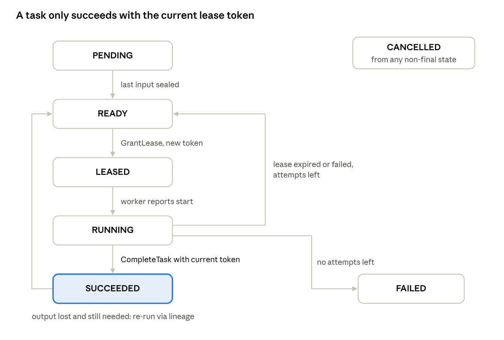

# Helix architecture

Helix splits into a **control plane** that owns all metadata (Go, Raft-replicated) and **worker nodes** that own all compute and tensor bytes (C++). Control traffic goes down from the control plane over gRPC; tensor bytes move sideways between workers over Helix's own io_uring transport and never pass through the control plane.



This document explains the moving parts and how a request flows through them. The binding details (exact interfaces, message layouts, defaults) are in [SPEC.md](SPEC.md); the reasoning and alternatives are in [docs/design/000-system-design.md](docs/design/000-system-design.md).

## 1. Processes

| Process | Language | Count | Owns | Ports |
| --- | --- | --- | --- | --- |
| `helix-meta` | Go | 3 (or 5) | Jobs, tasks, leases, object directory, node membership — all through Raft | 7000 client/worker gRPC · 7100 Raft gRPC · 9100 `/metrics` |
| `helixd` | C++ | 1 per machine | Running tasks, the local object store, serving fetches | 7200 data plane (helix-rpc) · 9200 `/metrics` |
| `helixctl` | Go | CLI | Nothing | talks to 7000 |

## 2. Components

### Control plane: `helix-meta`

```
meta/
├── api/    gRPC services: Cluster, Jobs, Tasks, Objects (NOT_LEADER redirects)
├── raft/   leader election (PreVote, CheckQuorum), replication, ReadIndex, snapshots
├── wal/    segmented write-ahead log with CRC32C, group commit, recovery
├── sm/     deterministic state machine: nodes, jobs, tasks, leases, objects, dedup
├── sched/  leader-only global scheduler: locality + load scoring, leases, lineage
├── sim/    simulated network for deterministic tests
└── cmd/    helix-meta and helixctl binaries
```

- Every state change is a **Raft command** (`SubmitJob`, `GrantLease`, `CompleteTask`, ...) applied by every replica in the same order. Followers redirect clients to the leader.
- The **scheduler** runs only on the leader. It turns `READY` tasks into `GrantLease` commands. The Raft index of that command becomes the lease's **fencing token**.
- **Heartbeats are not Raft writes**: the leader tracks liveness in memory and proposes `MarkNodeState` only on transitions (alive → suspect → dead).

### Worker: `helixd`

```
worker/   MetaClient (gRPC) · LeaseManager · Executor · DataServer · Fetcher · Metrics
core/     SlabAllocator · SpscRing · WsDeque · ThreadPool · TaskGraph · Tensor · kernels
rpc/      UringTransport (+ EpollTransport) · framing · Client/Server · credits
store/    ObjectStore over a memfd + mmap region · extent allocator · LRU eviction
```

- **Threading model**: one compute thread per physical core, pinned and grouped by NUMA node, each owning a Chase–Lev deque; idle threads steal (same NUMA node first). Separately, 2 I/O threads each own an io_uring and their connections; no locks on the I/O path. One gRPC thread talks to the control plane.
- **Memory**: tensors and buffers come from the slab allocator, carved from huge-page regions; network receive buffers are registered with io_uring; object-store extents live in one `MAP_SHARED` region.

## 3. Request lifecycle

1. **Submit.** `helixctl submit dag.json` → leader proposes `SubmitJob`; once committed, the job is durable and tasks are `READY` or `PENDING`.
2. **Place.** The scheduler scores candidate nodes (input bytes already local, queue depth, free store) using power-of-two choices, then commits a batch of `GrantLease` commands.
3. **Dispatch.** The leader pushes each lease down the worker's `WatchLeases` stream.
4. **Fetch inputs.** For inputs not local, the worker asks `Objects.Locate`, then sends `FETCH_OBJECT` to a peer; the bytes arrive directly into a `store.create()` extent (zero-copy receive), within credit-based flow control.
5. **Execute.** The executor runs the kernel on the work-stealing pool; outputs are written straight into store extents and sealed with the lease's fencing token.
6. **Complete.** The worker calls `Tasks.Complete(token)`; the leader commits `CompleteTask` only if the token is current. Children whose inputs are all sealed become `READY`.
7. **Recover.** If a lease expires (worker dead, paused or partitioned), the task goes back to `READY` with a new token; if an output was lost, its producer is re-run (lineage).



## 4. Data paths and who copies what

| Path | Mechanism | Copies in Helix code |
| --- | --- | --- |
| Client → meta | gRPC/protobuf | n/a (control path; convenience wins) |
| meta ↔ meta | Raft over gRPC, batched and pipelined | n/a |
| meta → worker | gRPC server stream | n/a |
| worker → worker (tensors) | helix-rpc: 32-byte header + raw payload, io_uring registered buffers, `send_zc` above 64 KiB | **zero**: send from the mmap extent, receive into the destination extent |
| task → task (same node) | object-store reference | zero (refcounted view) |

## 5. Failure handling at a glance

| Failure | Detection | Recovery |
| --- | --- | --- |
| Worker crash | missed heartbeats (dead after 10 s) | leases expire; tasks re-leased; lost objects rebuilt from lineage |
| Worker pause / partition | lease not renewed in 5 s | task re-leased; stale completion rejected by fencing token |
| Meta leader crash | follower election timeout | new leader in < 1 s; leases get a fresh TTL |
| Meta minority partition | CheckQuorum | old leader steps down; minority rejects writes |
| Torn WAL write | CRC/length check on recovery | truncate to last valid record |

Complete matrix with named tests: [SPEC.md §6](SPEC.md#6-failure-scenarios).

## 6. Where to go next

- How each part works in theory: [docs/concepts/](docs/concepts/)
- Exact APIs: [docs/api/](docs/api/) · storage formats: [docs/db/](docs/db/)
- Why it is built this way: [docs/adr/](docs/adr/) and [docs/design/](docs/design/)
