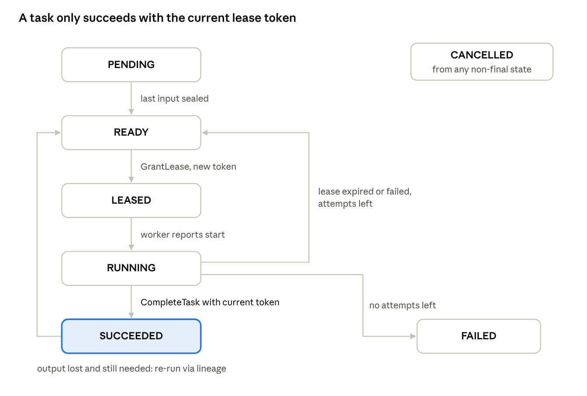

# Helix engineering specification (SPEC.md)

> Status: **living document**, version tracked in git. Rules: code and this file must agree; change this file in the same commit as any interface, format, protocol or default change. Section numbers are stable and referenced from code comments, docs and the day guide (e.g. "Spec §5.2").

The binding technical contract for Helix: every interface, format, state machine, protocol, default and test rule. When code and this tab disagree, fix one of them the same day.

## 1. Conventions

One repo, two languages, one build entry point, and the same definition of done for every change.

### Repository layout (45-day scope)

```
helix/
├── Makefile                  # single entry point: build, test, tsan, asan, bench, cluster-up
├── CMakeLists.txt            # C++ root
├── go.mod                    # Go module: github.com/<you>/helix
├── proto/                    # gRPC/protobuf: meta.proto, worker.proto
├── core/                     # libhelix-core (C++20)
│   ├── include/helix/{base,mem,sync,sched,tensor,kernels}/
│   ├── src/  test/  bench/
├── rpc/                      # helix-rpc data plane (C++): codec, transport, client, server
├── store/                    # helix-store object store (C++)
├── worker/                   # helixd daemon (C++), gRPC client of meta
├── meta/                     # helix-meta (Go)
│   ├── raft/  wal/  sm/  sched/  api/  sim/
│   └── cmd/{helix-meta,helixctl}/
├── bench/                    # loadgen/, baselines/{grpc,ray}/, results/, plot/
├── test/chaos/               # kill, partition, pause scripts + checker
├── deploy/                   # docker-compose.yml, Dockerfiles, terraform/
├── tools/bpf/                # bpftrace scripts
├── docs/{adr,design,benchmarks,postmortems,runbooks}/
└── notes/                    # your daily notes (git-ignored or a private branch)
```

### Toolchain and dependencies

| Area | Choice | Why |
| --- | --- | --- |
| C++ | C++20, clang 18 (Ubuntu 24.04 default), `-Wall -Wextra -Werror` | Concepts, `std::span`, `std::atomic_ref`, good sanitizers |
| C++ build | CMake 3.28 + Ninja; GoogleTest and Google Benchmark via `FetchContent` | Simple, no package manager to learn |
| C++ libraries | liburing, libnuma, OpenBLAS, gRPC + protobuf (apt), HdrHistogram\_c | All available on arm64 and x86 |
| Go | Go 1.23+, gRPC, `prometheus/client_golang`, `anishathalye/porcupine` | No Raft library: you write Raft |
| Lint/format | clang-format (Google style, 100 columns), clang-tidy, gofmt, golangci-lint | Enforced in CI |

### Make targets

| Target | Does |
| --- | --- |
| `make build` | Release build of C++ and Go |
| `make test` | All unit tests (C++ and `go test ./...`) |
| `make asan` / `make tsan` / `make ubsan` | Sanitizer builds + tests |
| `make race` | `go test -race ./...` |
| `make bench` | Microbenchmarks, results to `bench/results/<date>/` |
| `make cluster-up` / `cluster-down` | 3 meta + 3 worker containers via docker compose |
| `make chaos` | Chaos run against the compose cluster |
| `make lint` | Formatters and linters |

### Code rules

- **C++ errors:** no exceptions on hot paths. Return `helix::Status` or `helix::Result<T>` (a small type in `core/include/helix/base/status.h`). Abort only on broken invariants, via `HELIX_CHECK`.
- **C++ ownership:** RAII everywhere; raw pointers never own; no `new`/`delete` outside allocators.
- **Atomics:** every atomic operation names its memory order explicitly and has a comment saying which operation it pairs with.
- **Hot structures:** pad fields written by different threads to `helix::kCacheLine` (128, which covers both x86 adjacent-line prefetch and Apple's 128-byte lines).
- **Go:** contexts on every RPC; no goroutine without an owner that stops it; errors wrapped with `%w`.
- **Logging:** structured (key=value); no logging on per-message hot paths, only counters.
- **Names:** C++ types `PascalCase`, functions `snake_case`, constants `kName`; Go per standard style.

### Git workflow

- `main` always green. One short branch per day or feature: `day-07-thread-pool`.
- Conventional Commits: `feat(core): add Chase-Lev deque`, `fix(meta): ...`, `perf(rpc): ...`, `test`, `docs`, `bench`.
- Merge via pull request even when solo; the PR description says what changed, how it was tested, and benchmark deltas.
- Tag `v0.1` … `v0.5` at milestone ends, each with release notes.

### Definition of done (every change)

- [ ] Unit tests for the new behaviour, including one failure case
- [ ] `make test`, `make tsan` and `make asan` (C++) or `make race` (Go) green
- [ ] Benchmark run and recorded if the change touches a hot path
- [ ] This spec, the relevant design doc or an ADR updated if behaviour or an interface changed
- [ ] No `TODO` without an issue number

## 2. Component specs

Five components, each with one owner of its state: core and store are libraries inside the worker; rpc is the data plane; meta owns all cluster metadata.

| Component | Language | Owns | Talks to |
| --- | --- | --- | --- |
| `libhelix-core` | C++ | Memory, queues, local scheduling, kernels | (library) |
| `helix-rpc` | C++ | Framing, connections, bulk transfer | Peer workers |
| `helix-store` | C++ | Object bytes on one node | Local executor; peers via rpc |
| `helixd` (worker) | C++ | Running tasks on one node | meta (gRPC), peers (helix-rpc) |
| `helix-meta` | Go | Nodes, jobs, tasks, leases, object directory | Workers and clients (gRPC), replicas (gRPC) |
| `helixctl` | Go | Nothing (CLI) | meta (gRPC) |

### libhelix-core

**Threading:** one worker thread per core, pinned. All structures are safe for the documented callers only (e.g. SPSC = exactly one producer thread and one consumer thread).

```cpp
namespace helix {
// mem/
class PageSource {            // reserves and commits large regions
 public:
  static Result<PageSource> create(size_t reserve_bytes, int numa_node /* -1 = any */, bool huge);
  Result<std::span<std::byte>> commit(size_t bytes);   // 2 MB granularity
  void release(std::span<std::byte>);
};
class SlabAllocator {         // size classes 64 B .. 256 KB; larger goes to PageSource
 public:
  void* allocate(size_t bytes, size_t align = 64);
  void  deallocate(void* p, size_t bytes);
  SlabStats stats() const;    // per-class allocs, frees, depot transfers
};
class Arena { public: void* allocate(size_t, size_t align); void reset(); };

// sync/
template <class T, size_t N> class SpscRing {   // N power of two
 public: bool try_push(T&&); std::optional<T> try_pop(); };
template <class T> class WsDeque {              // Chase-Lev; owner: push/pop, others: steal
 public: void push(T); std::optional<T> pop(); StealResult<T> steal(); };

// sched/
class ThreadPool {
 public:
  explicit ThreadPool(PoolConfig);              // threads, pinning, numa grouping
  void spawn(Task t);                           // from a worker: local deque; else injection queue
  void wait_idle();
  PoolStats stats() const;                      // tasks, steals (local/remote), parks
};
class TaskGraph {                               // DAG with atomic dependency counters
 public: NodeId add(TaskFn, std::span<const NodeId> deps); Status run(ThreadPool&); };

// tensor/
struct Tensor { DType dtype; Shape shape; std::byte* data; size_t bytes; };  // 64 B aligned, row-major
// kernels/
Status sgemm(const Tensor& a, const Tensor& b, Tensor& c);   // backend: naive | blocked | neon | blas
}
```

### helix-rpc (data plane)

**Threading:** N I/O threads, each with its own io\_uring and its own connections; no locks on the I/O path. Callbacks run on the I/O thread and must not block.

```cpp
class Transport {             // implemented by UringTransport and EpollTransport
 public:
  virtual Result<ConnId> connect(const Endpoint&) = 0;
  virtual Status listen(const Endpoint&, AcceptFn) = 0;
  virtual Status send(ConnId, Frame&&) = 0;       // takes ownership of payload buffer
  virtual void   run() = 0;                       // event loop
};
class Client {
 public:
  Future<Response> call(ConnId, MsgType, std::span<const std::byte> meta, Deadline);
  Future<ObjectView> fetch(ConnId, ObjectId, StoreSink&);  // payload lands in a store extent
};
class Server { public: void handle(MsgType, Handler); };
```

### helix-store

**Rules:** objects are immutable once sealed; readers hold references; only unreferenced sealed objects are evicted.

```cpp
class ObjectStore {
 public:
  static Result<ObjectStore> open(StoreConfig);              // memfd + mmap, capacity
  Result<WritableObject> create(ObjectId, size_t bytes);     // reserve space, state CREATING
  Status seal(ObjectId, FencingToken);                       // CREATING -> SEALED; rejects stale token
  Result<ObjectRef> get(ObjectId);                           // refcount++; RAII release
  Status abort(ObjectId);                                    // drop a CREATING object
  StoreStats stats() const;                                  // used, evictions, hits, misses
};
```

### helixd (worker)

Modules: `MetaClient` (gRPC: register, heartbeat, lease stream, report), `LeaseManager` (renewals, cancellation), `Executor` (turns a lease into a TaskGraph run on the pool), `ObjectStore`, `DataServer` (serves FETCH\_OBJECT), `Fetcher` (pulls missing inputs), `Metrics` (HTTP `/metrics`).

### helix-meta (Go)

```go
// raft/
type Raft interface {
    Propose(ctx context.Context, cmd []byte) (index uint64, term uint64, err error)
    ReadBarrier(ctx context.Context) error          // leader confirmed for a linearizable read
    State() (term uint64, isLeader bool)
    Snapshot(index uint64, data []byte) error
    Stop()
}
// Committed entries arrive on: ApplyCh <-chan ApplyMsg {Index, Term, Command | Snapshot}

// sm/: the deterministic state machine; Apply must not do I/O or read clocks
type StateMachine interface {
    Apply(index uint64, cmd Command) Result
    Snapshot() ([]byte, error)
    Restore([]byte) error
}

// sched/: runs only on the leader; proposes GrantLease and ExpireLease commands
type Scheduler interface { Run(ctx context.Context) }
```

**gRPC services** (`proto/meta.proto`): `Cluster.RegisterNode`, `Cluster.Heartbeat`, `Cluster.WatchLeases` (server stream), `Tasks.Complete`, `Tasks.Fail`, `Jobs.Submit`, `Jobs.Get`, `Jobs.Cancel`, `Objects.Locate`. Followers answer with `NOT_LEADER` plus the leader's address; clients retry there.

## 3. Wire format (helix-rpc data plane)

Every message is a 32-byte header, then an optional metadata section, then an optional raw payload; all integers are little-endian.

### Frame header

| Offset | Size | Field | Notes |
| --- | --- | --- | --- |
| 0 | 4 | `magic` | `0x31584C48` ("HLX1" in memory order); reject anything else |
| 4 | 1 | `version` | `1`; reject higher versions |
| 5 | 1 | `type` | Message type, table below |
| 6 | 2 | `flags` | Bit flags, table below |
| 8 | 8 | `request_id` | Unique per connection per direction; responses echo it |
| 16 | 4 | `stream_id` | 0 for unary; groups chunks of one transfer |
| 20 | 4 | `meta_len` | Bytes of metadata after the header; max 64 KiB |
| 24 | 4 | `payload_len` | Bytes of payload after the metadata; max 1 GiB per frame |
| 28 | 4 | `header_crc` | CRC32C of bytes 0–27 |

```cpp
struct alignas(8) FrameHeader {
  uint32_t magic; uint8_t version; uint8_t type; uint16_t flags;
  uint64_t request_id; uint32_t stream_id; uint32_t meta_len; uint32_t payload_len; uint32_t header_crc;
};
static_assert(sizeof(FrameHeader) == 32);
```

### Message types

| Code | Name | Meta | Payload |
| --- | --- | --- | --- |
| `0x01` | `HELLO` | node\_id u32, protocol features u64 | — |
| `0x02` | `HELLO_ACK` | node\_id u32, initial credit u64 | — |
| `0x10` | `REQUEST` | method u16 + method-specific struct | optional |
| `0x11` | `RESPONSE` | status u16 + method-specific struct | optional |
| `0x12` | `ERROR` | status u16, message (≤ 1 KiB UTF-8) | — |
| `0x20` | `FETCH_OBJECT` | object\_id\[16\], offset u64, length u64 | — |
| `0x21` | `OBJECT_DATA` | object\_id\[16\], offset u64, total\_size u64 | object bytes (chunk) |
| `0x22` | `OBJECT_NOT_FOUND` | object\_id\[16\] | — |
| `0x30` | `CREDIT` | additional\_bytes u64 | — |
| `0x40` / `0x41` | `PING` / `PONG` | timestamp\_ns u64 | — |
| `0x50` | `CANCEL` | request\_id\_to\_cancel u64 | — |

In M5, every request's metadata gains a 24-byte trace context (trace\_id 16 B, parent span\_id 8 B) behind flag bit 4.

### Flags

| Bit | Name | Meaning |
| --- | --- | --- |
| 0 | `END_STREAM` | Last frame of this stream |
| 1 | `PAYLOAD_CRC` | A CRC32C of the payload follows it (4 bytes, not counted in `payload_len`) |
| 2 | `DEADLINE` | Metadata starts with an absolute deadline (u64 ns, sender's monotonic clock converted at send) |
| 3 | reserved | Compression (not in scope) |
| 4 | `TRACE` | Trace context present |

### Rules

1. Read exactly 32 bytes; verify magic, version and `header_crc` before trusting any length.
2. Reject `meta_len` > 64 KiB or `payload_len` > 1 GiB with an `ERROR` and close the connection.
3. Metadata structs are fixed-layout, little-endian, versioned by message type (no FlatBuffers needed in the 45-day scope; record this in an ADR).
4. Object transfers are chunked: 4 MiB per `OBJECT_DATA` frame by default, same `stream_id`, `END_STREAM` on the last.
5. A sender may only put payload bytes on the wire while it holds credit; `CREDIT` frames refill it (section 5).
6. Unknown message types get `ERROR(UNSUPPORTED)`; unknown flag bits are ignored.

### Status codes

`0 OK`, `1 CANCELLED`, `2 DEADLINE_EXCEEDED`, `3 NOT_FOUND`, `4 STALE_TOKEN`, `5 RESOURCE_EXHAUSTED`, `6 UNSUPPORTED`, `7 INVALID`, `8 INTERNAL`.

## 4. Data model and state machines

All cluster state lives in the meta state machine and changes only through committed Raft commands; workers hold leases and object bytes, nothing authoritative.

### Identifiers

| ID | Format | Assigned by | Notes |
| --- | --- | --- | --- |
| `NodeId` | u32 | meta, at registration (Raft index-derived) | Never reused |
| `JobId` | u64 | meta, the Raft index of `SubmitJob` | Unique and ordered |
| `TaskId` | (JobId u64, index u32) | Client, position in the DAG | Deterministic |
| `ObjectId` | 16 bytes: JobId u64 + task index u32 + output index u32 | Derived from the producing task | Lineage is implicit: the ID names its producer |
| `Attempt` | u32 | meta, per task | Starts at 1, +1 per re-lease |
| `FencingToken` | u64 | meta: the Raft index of the `GrantLease` command | Strictly increasing per task |
| `RequestId` | 128-bit client-generated | Client | Idempotency key for `Submit` |

### Tables in the state machine

| Table | Key | Fields |
| --- | --- | --- |
| nodes | NodeId | address, data\_port, cores, numa\_nodes, memory\_bytes, store\_capacity, state, last\_heartbeat (leader-local, not replicated) |
| jobs | JobId | request\_id, state, task\_count, tasks\_done, submitted\_at\_index, error |
| tasks | TaskId | kernel name + params, input ObjectIds, output count, state, attempt, max\_attempts, current lease |
| leases | TaskId | node\_id, fencing\_token, ttl\_ms (expiry tracked by the leader in memory) |
| objects | ObjectId | size\_bytes, locations (set of NodeId), state, pin\_count (consumers still pending) |
| dedup | RequestId | JobId (so a retried `Submit` returns the same job) |

### Raft commands

`RegisterNode`, `MarkNodeState`, `SubmitJob`, `GrantLease`, `RenewLeases` (only when the TTL policy changes; routine renewals stay in leader memory), `ExpireLease`, `CompleteTask` (with output sizes and the reporting node), `FailTask`, `AddObjectLocation`, `RemoveObjectLocation`, `ReconstructObject`, `CancelJob`, `GcJob`. Each is a protobuf message with a type tag; `Apply` is a switch on that tag.

### Task lifecycle

| From | Event | To | Side effects |
| --- | --- | --- | --- |
| — | `SubmitJob` | `PENDING` (has unfinished inputs) or `READY` | — |
| `PENDING` | last input object becomes `SEALED` | `READY` | — |
| `READY` | scheduler commits `GrantLease` | `LEASED` | attempt++, new fencing token |
| `LEASED` | worker reports start (heartbeat) | `RUNNING` | — |
| `LEASED`/`RUNNING` | `CompleteTask` with the current token | `SUCCEEDED` | outputs added to objects, children re-evaluated |
| `LEASED`/`RUNNING` | `CompleteTask` with an old token | (unchanged) | reply `STALE_TOKEN`; worker drops its output |
| `LEASED`/`RUNNING` | `ExpireLease` or `FailTask`, attempts left | `READY` | lease removed |
| `LEASED`/`RUNNING` | `ExpireLease` or `FailTask`, no attempts left | `FAILED` | job → `FAILED` |
| `SUCCEEDED` | an output object is lost and still needed | `READY` | `ReconstructObject`; inputs checked recursively |
| any non-final | `CancelJob` | `CANCELLED` | leases revoked |



Two loops bring a task back to READY: a lost lease (retry, counted against attempts) and a lost output (lineage re-run). Only a completion carrying the current fencing token reaches SUCCEEDED.

### Object lifecycle

`CREATING` (worker-local, writable) → `SEALED` (immutable, registered in meta) → replicas added as consumers fetch it → `LOST` when its last location disappears → `RECONSTRUCTING` while its producer reruns → `SEALED` again. An object is garbage-collected when its job finishes and no client holds a result reference.

### Node lifecycle

`ALIVE` → `SUSPECT` (no heartbeat for 3 s) → `DEAD` (10 s) → its leases expire and its object locations are removed. A dead node that comes back registers again with a new NodeId and an empty store. `DRAINING` is set by an operator: no new leases, running ones finish.

### Job lifecycle

`SUBMITTED` → `RUNNING` (first lease) → `SUCCEEDED` (all tasks done) | `FAILED` (any task out of attempts) | `CANCELLED`.

## 5. Protocols

Six protocols cover everything Helix does; each is written as numbered steps so you can implement and test them one step at a time.

### 5.1 Job submission

1. Client calls `Jobs.Submit(request_id, dag)` on any meta replica; a follower answers `NOT_LEADER(leader_addr)` and the client retries there.
2. Leader validates the DAG (acyclic, inputs reference earlier tasks or existing objects, kernels known), then proposes `SubmitJob`.
3. On apply: if `request_id` is in `dedup`, return the existing JobId; otherwise create the job and its tasks (`READY` if no inputs, else `PENDING`).
4. Leader replies with JobId once the entry is committed and applied.

### 5.2 Lease grant, renewal and expiry

1. Each worker keeps one `Cluster.WatchLeases` stream open to the leader.
2. The leader's scheduler loop (every 5 ms or when work appears) picks `READY` tasks, scores nodes (5.6), and proposes a batch of `GrantLease` commands.
3. On apply: task → `LEASED`, attempt++, `fencing_token` = this entry's Raft index. The leader pushes the lease down the worker's stream.
4. The worker renews every `lease_ttl / 3` via `Cluster.Heartbeat` listing its running tasks. Renewals update leader memory only; no Raft write.
5. If a lease isn't renewed within `lease_ttl`, the leader proposes `ExpireLease`; on apply the task returns to `READY` (or `FAILED` when out of attempts).
6. **Leader change:** the new leader doesn't know the old leader's timers, so it treats every existing lease as freshly renewed and gives it a full TTL. Safe because fencing tokens, not clocks, decide who may write.
7. **Worker side:** if a worker can't reach the leader for `lease_ttl`, it cancels its running tasks itself; its results would be rejected anyway.

### 5.3 Execution and sealing

1. Worker receives the lease, resolves inputs: local objects are pinned; missing ones are fetched (5.4).
2. Executor runs the kernel; outputs are written directly into `store.create()` buffers.
3. Worker calls `store.seal(id, token)` locally, then `Tasks.Complete(task, attempt, token, output_sizes)`.
4. Leader proposes `CompleteTask`; on apply it succeeds only if `token` equals the task's current lease token. Otherwise the reply is `STALE_TOKEN` and the worker aborts its local outputs.
5. On success: task → `SUCCEEDED`, output objects → `SEALED` with this node as a location, children whose inputs are all sealed → `READY`.

### 5.4 Object fetch

1. Consumer asks `Objects.Locate(ids)` (cached; refreshed on failure) and picks the location with the most free bandwidth (initially: random).
2. Opens or reuses a helix-rpc connection to that node's data port; sends `FETCH_OBJECT`.
3. Producer pins the object (refcount++), streams `OBJECT_DATA` chunks straight from the mmap region with `send_zc`, within the consumer's credit.
4. Consumer receives each chunk directly into the extent from `store.create()`, sends `CREDIT` as it consumes, and seals on `END_STREAM`.
5. Consumer reports `AddObjectLocation` asynchronously (batched), so later consumers can fetch from it too.
6. On connection loss or `OBJECT_NOT_FOUND`: abort the partial object, try the next location, then ask meta again; if no location exists, the object is `LOST` (5.5).

### 5.5 Failure recovery

1. **Worker death:** the leader marks it `DEAD` after 10 s without heartbeats; proposes `ExpireLease` for its leases and `RemoveObjectLocation` for its objects.
2. **Lost object:** an object with zero locations that is still needed by a non-finished task is marked `LOST`; its producing task goes back to `READY` (attempt++), recursively for its own lost inputs. This is lineage reconstruction.
3. **Duplicate results:** two attempts may both finish; only the one with the current token is accepted (5.3 step 4).
4. **Meta leader death:** Raft elects a new leader within \~2 election timeouts; workers' streams reconnect to it; leases continue (5.2 step 6).

### 5.6 Placement and spillback

1. **Score** for task t on node n: `score = 4·locality(t,n) + 2·(1 − queue_depth(n)/capacity(n)) + 1·(free_store(n)/store_capacity(n))`, where locality is the fraction of t's input bytes already on n. Weights live in config.
2. **Power of two choices:** score only 2 random candidates plus the best-locality node, not every node.
3. **Spillback:** a worker whose local queue exceeds `spillback_threshold` refuses a new lease with `RESOURCE_EXHAUSTED`; the leader proposes `ExpireLease` immediately (attempt not counted) and re-places it.

## 6. Failure scenarios

Every row below needs an automated test before v0.4; the Test column names where it lives.

| Scenario | How Helix detects it | What Helix does | Test |
| --- | --- | --- | --- |
| Worker process crashes (`kill -9`) | Heartbeats stop; stream closes | `DEAD` after 10 s; leases expire; objects removed; tasks and lost objects re-run | chaos: `kill_worker` |
| Worker pauses (`SIGSTOP` 30 s) | Lease not renewed | Task re-leased elsewhere; resumed worker's `CompleteTask` gets `STALE_TOKEN` | chaos: `pause_worker` |
| Worker cut off from meta, peers fine | Heartbeats fail | Worker self-cancels after `lease_ttl`; meta re-leases | chaos: `partition worker↔meta` |
| Meta follower crashes | Leader's AppendEntries fail | Nothing visible; follower catches up on restart (log or snapshot) | raft sim: `TestFollowerRestart` |
| Meta leader crashes | Followers' election timeout | New leader in < 1 s; clients and workers reconnect; leases get a fresh TTL | raft sim + chaos: `kill_leader` |
| Meta minority partitioned | Partitioned leader loses quorum (CheckQuorum) | It steps down; majority side elects a leader; minority rejects writes | raft sim: `TestPartitionLeader` |
| Torn last WAL record | CRC or length check fails on recovery | Truncate at the last valid record; continue | wal: `TestTornTail` |
| Disk full on meta | `write`/`fsync` returns an error | Stop accepting proposals; report unhealthy; never acknowledge an unsynced write | wal: `TestDiskFull` (fault-injecting file) |
| Object evicted or node lost before a consumer ran | Fetch returns `NOT_FOUND` / no locations | Object `LOST` → producer re-run via lineage | integration: `TestLineageRebuild` |
| Fetch connection drops mid-transfer | Socket error or timeout | Abort partial object; retry another location; then ask meta | rpc: `TestFetchInterrupted` |
| Straggler (slow but alive worker) | Task running > 3× the median for its kernel | 45-day scope: log and count it. Stretch: speculative copy | metric only |
| Duplicate `CompleteTask` (client retry) | Token already consumed | Idempotent: second call returns the same result | sm: `TestCompleteTwice` |
| Client retries `Submit` | `request_id` in dedup table | Returns the same JobId | sm: `TestSubmitIdempotent` |
| Corrupt frame on the wire | Header CRC fails | `ERROR(INVALID)`, close connection | fuzz + rpc: `TestBadCrc` |
| Store full | `create` fails | Evict unreferenced sealed objects (LRU); if still full, refuse the lease (spillback) | store: `TestEvictionUnderPressure` |

## 7. Configuration and defaults

Every binary reads one TOML file (`--config`) and lets flags override it; these defaults are tuned for the Mac VM and docker compose, and each has a reason so you know when to change it.

| Key | Default | Component | Reason / when to change |
| --- | --- | --- | --- |
| `raft.election_timeout_ms` | 150–300 (random) | meta | Raft paper range; raise to 500–1000 on slow cloud disks |
| `raft.heartbeat_ms` | 50 | meta | Well under the election timeout |
| `raft.max_batch_entries` | 256 | meta | Group commit size |
| `raft.max_batch_wait_us` | 500 | meta | Latency cap for batching |
| `raft.snapshot_every_entries` | 10,000 | meta | Keeps replay under \~1 s |
| `wal.segment_bytes` | 64 MiB | meta | Easy deletion after snapshots |
| `lease.ttl_ms` | 5,000 | meta, worker | Trade-off: recovery time vs false expiries |
| `lease.renew_every_ms` | 1,500 | worker | ttl / 3, survives one lost heartbeat |
| `node.suspect_after_ms` / `dead_after_ms` | 3,000 / 10,000 | meta | Dead must exceed ttl so leases expire first |
| `task.max_attempts` | 3 | meta | Stops poison tasks looping forever |
| `sched.tick_ms` | 5 | meta | Scheduling latency floor |
| `sched.weights` | locality 4, load 2, store 1 | meta | Tune on day 33 with the skew benchmark |
| `worker.threads` | physical cores | worker | One per core, pinned |
| `worker.spin_before_park_us` | 20 | worker | Measure on day 7; lower if CPU use matters |
| `worker.spillback_threshold` | 2 × threads | worker | Queue depth that triggers refusal |
| `store.capacity_bytes` | 2 GiB (Mac VM), 32 GiB (cloud) | worker | Fit the machine |
| `store.alignment_bytes` | 4 KiB | worker | Page-aligned extents; required for `send_zc` and DMA |
| `rpc.io_threads` | 2 | worker | One ring per thread |
| `rpc.sq_entries` | 256 | worker | Queue depth per ring |
| `rpc.chunk_bytes` | 4 MiB | worker | Object transfer chunk |
| `rpc.initial_credit_bytes` | 16 MiB | worker | Bounded in-flight data per connection |
| `rpc.send_zc_min_bytes` | 64 KiB | worker | Below this, copy is cheaper (measure on day 15) |
| `rpc.connect_timeout_ms` / `request_timeout_ms` | 1,000 / 5,000 | worker | Fail fast, then retry elsewhere |

### Ports

| Port | Use |
| --- | --- |
| 7000 | meta client/worker gRPC |
| 7100 | meta ↔ meta Raft gRPC |
| 7200 | worker data plane (helix-rpc) |
| 9100 | meta `/metrics` |
| 9200 | worker `/metrics` |

## 8. Metrics and tracing catalog

Every metric is named here before it is coded, so dashboards, benchmarks and the README all use the same names. Prefix `helix_`; units in the name; latency as histograms in seconds.

| Metric | Type | Labels | Component | Answers |
| --- | --- | --- | --- | --- |
| `helix_core_tasks_executed_total` | counter | worker\_thread | core | Throughput per thread |
| `helix_core_steals_total` | counter | result=success\|empty\|abort, scope=local\_numa\|remote\_numa | core | Is stealing working, and where from? |
| `helix_core_parks_total` | counter | — | core | Are threads sleeping too often? |
| `helix_core_queue_depth` | gauge | worker\_thread | core | Imbalance between threads |
| `helix_mem_bytes_in_use` | gauge | size\_class | core | Allocator footprint |
| `helix_mem_depot_transfers_total` | counter | direction=to\|from | core | Cross-thread allocator traffic |
| `helix_rpc_frames_total` | counter | type, direction | rpc | Message mix |
| `helix_rpc_bytes_total` | counter | direction | rpc | Bandwidth |
| `helix_rpc_request_duration_seconds` | histogram | method | rpc | RPC latency (p50/p99/p99.9) |
| `helix_rpc_credit_stalls_total` | counter | — | rpc | Is flow control throttling senders? |
| `helix_store_bytes_used` | gauge | — | store | Memory pressure |
| `helix_store_evictions_total` | counter | — | store | Is capacity too small? |
| `helix_store_fetch_duration_seconds` | histogram | outcome | store | Remote fetch cost |
| `helix_task_duration_seconds` | histogram | kernel, outcome | worker | Task runtime; straggler detection |
| `helix_task_queue_wait_seconds` | histogram | — | worker | Time from lease to start |
| `helix_lease_spillbacks_total` | counter | — | worker | Overload |
| `helix_raft_term` | gauge | — | meta | Elections happening? |
| `helix_raft_is_leader` | gauge | — | meta | Who leads |
| `helix_raft_commit_duration_seconds` | histogram | — | meta | Propose → commit latency |
| `helix_raft_fsync_duration_seconds` | histogram | — | meta | Disk cost |
| `helix_raft_batch_size` | histogram | — | meta | Group commit effectiveness |
| `helix_sched_decision_duration_seconds` | histogram | — | meta | Scheduler cost per batch |
| `helix_sched_tasks_ready` | gauge | — | meta | Backlog |
| `helix_job_duration_seconds` | histogram | outcome | meta | End-to-end job time |
| `helix_lease_expirations_total` | counter | reason=timeout\|node\_dead\|spillback | meta | Failure rate |

### Implementation rules

- Hot-path counters and histograms are per-thread (no atomics shared between threads), merged by a collector thread every second.
- Histograms use HdrHistogram with 3 significant digits, 1 µs to 60 s.
- Never put an unbounded value (task id, object id) in a label.

### Trace spans

| Span | Started by | Parent |
| --- | --- | --- |
| `job.submit` | meta API | client |
| `sched.place` | meta scheduler | `job.submit` |
| `task.run` | worker executor | `sched.place` (trace context in the lease) |
| `object.fetch` | worker fetcher | `task.run` |
| `rpc.call` | helix-rpc client | caller |
| `raft.commit` | meta leader | the API span that proposed |

The flight recorder keeps the last 64k events per thread (timestamp, event type, two u64 arguments) in a ring, dumped as Perfetto JSON on `SIGUSR1` or on crash.

## 9. Testing strategy

Each layer of tests catches a different class of bug; skipping a layer means shipping that class of bug.

| Layer | Tool | Catches | Runs | Required for |
| --- | --- | --- | --- | --- |
| Unit | GoogleTest, `go test` | Logic errors | Every commit (CI) | Every component |
| Randomized / property | Seeded random inputs vs a simple reference model | Edge cases you didn't think of | Every commit | Allocator, rings, deque, codec, state machine |
| Concurrency stress | TSan + many threads, 10–60 s | Data races, lost/duplicate items | CI (short), nightly (long) | All of `sync/`, `sched/`, `store/` |
| Memory errors | ASan, UBSan | Use-after-free, overflow, UB | CI | All C++ |
| Weak-memory | Run stress tests on ARM (your Mac) | Missing acquire/release | Daily, local | `sync/` |
| Fuzzing | libFuzzer (C++), `go test -fuzz` | Parser crashes on hostile input | 60 s in CI, 30 min before releases | Frame codec, WAL reader, command decoder |
| Raft simulation | In-process cluster with a simulated network | Election, replication, persistence bugs | CI (fast seeds), nightly (1,000 seeds) | meta/raft |
| Linearizability | Porcupine over recorded histories | Stale reads, lost writes | CI (50 runs), nightly | meta API |
| Integration | docker compose, 3 meta + 3 workers | Wiring and protocol errors | CI on merge | End-to-end jobs |
| Chaos | `test/chaos`: kill, pause, partition, + result checksums | Recovery bugs | Nightly, before every release | Section 6 rows |
| Benchmark regression | Fixed benchmark set, compare to last release | Performance regressions > 10% | Weekly, before releases | Hot paths |

### Rules

- **Deterministic seeds:** every randomized test prints its seed on failure, and `HELIX_SEED=<n>` reproduces it.
- **No sleeps for synchronization** in tests; wait on conditions with timeouts.
- **Flaky = broken:** a test that fails once in 100 runs is a bug, usually a real race. Run new concurrency tests 100 times before merging (`--gtest_repeat=100`, `go test -count=100`).
- **Reference models:** for each data structure keep a trivially correct version (mutex + `std::deque`, Go map) and compare outputs.
- **Fault injection hooks:** file writes, `fsync`, network sends and clocks go through small interfaces so tests can make them fail or lag.

### Coverage targets

Line coverage is a weak signal; aim for 80% on `core/`, `rpc/codec`, `meta/raft` and `meta/sm`, and 100% of section 6 rows covered by a named test.

## 10. Benchmark methodology

A benchmark is only worth publishing if someone else could rerun it and get the same shape of result, so every result carries its setup, its raw data and its uncertainty.

### Rules

1. **Write the hypothesis first:** the expected number and why. Being wrong is fine; it's the most useful part of the write-up.
2. **Fix the environment:** pin threads (`taskset`/`numactl`), set the CPU governor to `performance` where you can, close other workloads, record kernel version, CPU model, core count, memory, NIC and compiler flags (`bench/env.sh` prints all of it).
3. **Warm up** for at least 10% of the run or 5 s, and discard it.
4. **Repeat** at least 5 runs; report the median and the min–max (or 95% interval). Never report a single run.
5. **Open-loop load for latency:** send at a fixed rate (Poisson arrivals) and measure from the scheduled send time, not the actual send time, to avoid coordinated omission. Report p50, p90, p99, p99.9 and max, plus the achieved rate.
6. **Latency vs throughput curves**, not single points: sweep offered load from 10% to past saturation.
7. **Same conditions for baselines:** same machine, same payloads, same concurrency, baselines configured as their docs recommend (state the config).
8. **Keep raw data:** CSV per run in `bench/results/<date>-<name>/`, plus the plotting script. Charts are regenerated, never edited by hand.

### Benchmark set

| ID | What | Baseline | Day |
| --- | --- | --- | --- |
| B1 | SPSC ring ops/s | mutex + `std::deque` | 3 |
| B2 | Allocator alloc/free ns by size class | glibc malloc, mimalloc | 5 |
| B3 | Empty-task throughput vs threads | `std::async`, naive pool | 7 |
| B4 | SGEMM GFLOP/s by kernel | OpenBLAS | 9 |
| B5 | Tiled matmul DAG scaling 1→8 threads | single-threaded OpenBLAS | 10 |
| B6 | RPC 64 B latency vs load | gRPC C++ async | 17, 42 |
| B7 | Bulk transfer GB/s vs size | gRPC streaming, iperf3 | 15, 42 |
| B8 | Raft commit latency, writes/s | (etcd as stretch) | 27 |
| B9 | Recovery time after `kill -9` | — | 34 |
| B10 | Task throughput and DAG latency | Ray | 43 |
| B11 | NUMA: local-first vs random stealing | — | 42 |

### Report template

```markdown
# B6: RPC small-message latency vs gRPC
Date: …  Commit: …  Machine: … (env.sh output linked)
Hypothesis: Helix p99 at 50k req/s will be ≥ 2× lower than gRPC because …
Setup: client/server pinned to cores …; payload 64 B; open-loop, 60 s per point, 5 runs
Result: [chart] [table: rate, p50, p99, p99.9 for each system]
What explains it: … (with perf / flame graph evidence)
Where the baseline wins: …
Raw data: bench/results/…
```
