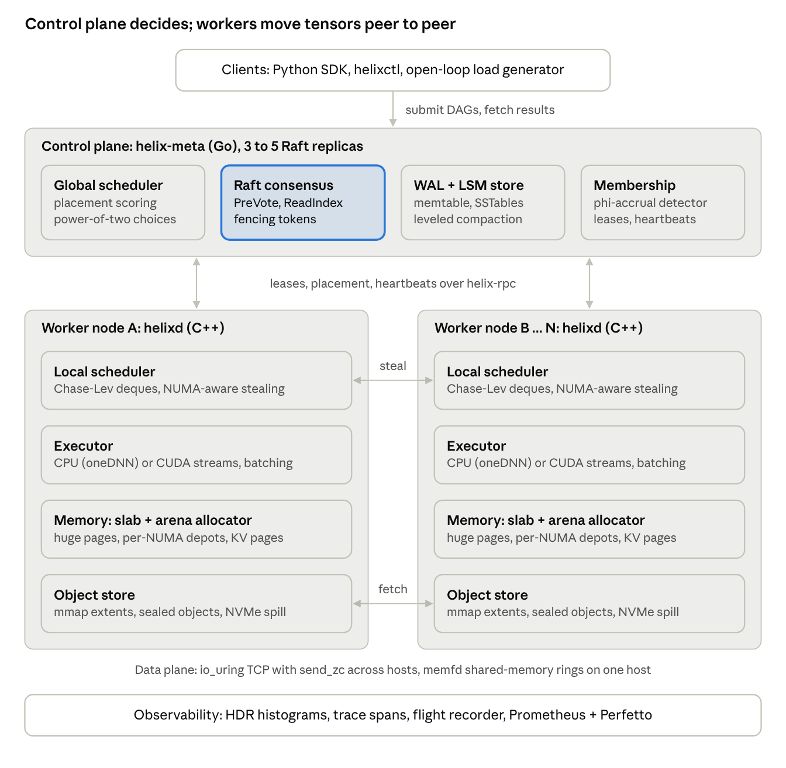
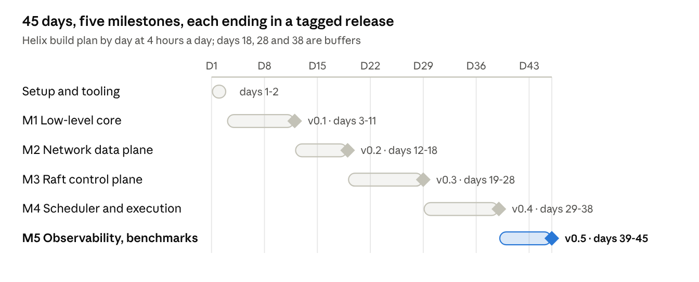

# Helix: Hardware-Aware Distributed Tensor Execution Fabric

Nov 10, 2026 · @Anshu

**This doc is the single source of truth for Helix.** This tab is the summary, the scope and the 45-day tracker. The detail lives in three more tabs: [Foundations refresher](../concepts/README.md) to rebuild the basics and system design, [Engineering spec](../../SPEC.md) for every interface, format and protocol, and the [Day guide](day-guide.md) for exactly what to do each day. If two places disagree, the Engineering spec wins on technical details and the Day guide wins on daily tasks; fix the other one the same day.

## 1. Vision

**Helix** is a hardware-aware, Raft-coordinated distributed runtime that schedules tensor-task DAGs across a cluster of C++ worker nodes, moves tensors between them with zero-copy transport, and keeps them in a memory-mapped, log-structured object store. It is the small, honest cousin of Ray + Plasma + a continuous-batching inference server, built from the allocator up in 45 days at 4 hours a day.

A client submits a job: a DAG of tasks such as `matmul`, `softmax`, `attention_block`, or a whole forward pass of a small transformer. The Go control plane, replicated with your own Raft, records the job, picks workers by NUMA locality, memory pressure and data locality, and hands out leases. Each C++ worker runs a NUMA-pinned work-stealing scheduler over lock-free deques, allocates tensors from a custom slab/arena allocator, and executes kernels on an CPU backend (NEON on ARM, AVX2 on x86) or, optionally, a CUDA stream backend. Outputs land in the node's mmap-backed object store; downstream tasks on other nodes pull them through Helix RPC over io\_uring (TCP) or a shared-memory ring (same host), with no copies between the socket and the tensor buffer.

The headline demo: a tiled-matmul and transformer-block DAG running across 3 workers in Docker, `kill -9` on a worker mid-run, and the job finishing anyway via re-execution and lineage, with p50/p99/p99.9 latency and task throughput charted against Ray. Pipeline-parallel LLM inference is the first stretch goal after day 45.

### Design goals

- **Hardware-aware:** NUMA-pinned threads, cache-line-aligned structures, huge pages, a memory budget per node that the scheduler respects.
- **Zero-copy data plane:** a tensor is written once into a registered buffer and never copied by Helix code on its way to a remote consumer.
- **Linearizable control plane:** all job, lease and placement metadata goes through Raft; workers are stateless apart from their object cache.
- **Fault tolerance by lineage:** lost objects are recomputed from the DAG, not checkpointed.
- **Measured, not claimed:** every component ships with a microbenchmark and a comparison against an industry baseline.

### Non-goals

- Training or autograd: inference and forward DAGs only.
- Writing competitive GEMM kernels from scratch. Write one tiled kernel to learn it, then call oneDNN/OpenBLAS (CPU) or cuBLAS (GPU) for the benchmarks.
- Multi-tenant security, auth, Kubernetes integration.
- Byzantine fault tolerance.

### Development environment

Build on your MacBook Air (M5, 24 GB) inside an ARM64 Ubuntu 24.04 machine run by **OrbStack**, and rent x86 cloud machines only for the short stretches that need real hardware. OrbStack is the pick over VirtualBox, UTM and Parallels because it is light, starts in seconds, shares files with macOS at near-native speed, and has Docker built in for the multi-node cluster.

| Work | Where | When | Why there |
| --- | --- | --- | --- |
| Daily coding, unit, sanitizer and chaos tests; Raft and RPC correctness; 5-node cluster in Docker | Mac: OrbStack ARM64 Ubuntu machine (8 cores, 14 GB) | All 45 days | io\_uring, memfd, futex, huge pages and eBPF all work; ARM's weaker memory ordering exposes lock-free bugs x86 hides |
| CUDA SGEMM vs cuBLAS | Kaggle notebook with a free T4 (Colab as backup) | Day 36 | No CUDA on Apple Silicon |
| NUMA run with `perf c2c`; Helix RPC vs gRPC across machines | GCP trial credit (AWS spot as fallback): one 2-socket x86 VM + 2 small VMs | \~4 h, day 42 | Real NUMA, hardware counters, a real network |
| Helix vs Ray benchmarks | Same cloud machines | \~4 h, day 43 | Numbers without Mac VM noise |

Cloud spend is ₹0 on GCP trial credit, or about ₹1,000–1,300 on AWS spot; section 4 has the budget. Keep a Terraform script in `deploy/` and destroy machines at the end of every session.

**Setup, day one:**

1. Install OrbStack and create an Ubuntu 24.04 (arm64) machine named `helix`; give OrbStack 8 cores and 14 GB, leaving 10 GB for macOS.
2. Install `clang`, `lld`, `cmake`, `ninja`, `liburing-dev`, `libnuma-dev`, `bpftrace`, Go, and OpenBLAS; keep the repo inside the Linux machine's filesystem for fast builds, and edit it from VS Code or CLion over the OrbStack mount.
3. Smoke-test the kernel: `uname -r` should be 6.1 or newer, liburing's bundled tests should pass, and `bpftrace -e 'BEGIN { exit(); }'` should run. If io\_uring or eBPF is restricted, switch to a UTM VM running the stock Ubuntu kernel; everything else in this plan stays the same.
4. Run the 3–5 node cluster with `docker compose` from OrbStack's built-in Docker.

**What the Mac cannot do, and the workaround:**

- No AVX2/AVX-512: write the learning SGEMM kernel with ARM NEON intrinsics, use OpenBLAS or oneDNN (both support arm64) as the backend, and add an AVX2 path on the x86 box.
- No real NUMA: keep the NUMA code behind `libnuma` checks so it degrades to one node; validate placement logic with a fake 2-node topology in UTM/QEMU if needed, but measure only on the x86 box.
- No hardware performance counters in the VM: use software `perf` events and flame graphs on the Mac; do IPC and `perf c2c` work on the rented box.
- No publishable benchmarks: VM numbers are for spotting regressions only.
- Keep an `epoll` fallback behind the transport interface so a non-io\_uring kernel still works.

**GPU:** Rent a single GPU (an L4 or A10G) only if Kaggle's free GPU quota runs out; RunPod's L4 costs about $0.59/hr.

## 2. Architecture

Helix splits into a Go control plane that owns all metadata through Raft, and C++ worker nodes that own all compute and tensor bytes; the two talk only over Helix RPC.



Control traffic flows down from the Raft-replicated control plane; tensor bytes flow sideways between workers' object stores and never pass through the control plane. Telemetry runs through every component.

### Request lifecycle

1. A client submits a DAG through the SDK. The leader appends `SubmitJob` to the Raft log; once committed, the job is durable.
2. The global scheduler scores candidate nodes (locality, memory headroom, queue depth, accelerator fit) and writes a lease per task group, each with a fencing token.
3. The worker's local scheduler pushes ready tasks onto per-core deques; idle cores steal, NUMA-local first.
4. The executor allocates outputs from the slab allocator directly inside an object-store extent, runs the kernel, and seals the object with the lease's fencing token.
5. The worker reports the new object location; the object directory is updated through Raft.
6. A downstream task on another node fetches its inputs with a zero-copy receive straight into its own store extent.
7. If a lease expires, the control plane bumps the token, re-queues the task, and walks lineage to rebuild any lost inputs.

### Interfaces

| Interface | Between | Transport | Format |
| --- | --- | --- | --- |
| Job API | Client ↔ control plane | Helix RPC (TCP); gRPC gateway for tools | FlatBuffers |
| Raft RPCs | Control plane replicas | Helix RPC (Go), pipelined | FlatBuffers + batched log entries |
| Lease / heartbeat | Control plane ↔ workers | Helix RPC, server streaming | FlatBuffers |
| Steal protocol | Worker ↔ worker | Helix RPC request/response | Task descriptors + object handles |
| Object fetch | Worker ↔ worker | io\_uring TCP with `send_zc`, or memfd shm ring | 32 B frame header + raw tensor bytes |
| Metrics / traces | All → collector | Prometheus scrape, OTLP | Text exposition, protobuf |

## 3. Milestones (full scope)

This section is the full-scope design, kept as the reference. Section 4 cuts it to a 45-day build; anything marked stretch there continues from here after day 45. Each milestone still ends in a tagged release (`v0.1` … `v0.5`), a design doc and a benchmark report.



Buffer days 18, 28 and 38 absorb slips. If you fall behind, drop the GPU and batching days (36–37) first; never drop the day 42–43 benchmarks.

### Milestone 1 — Low-level core (`libhelix-core`, C++20) · days 3–11

The goal is a single-node executor that runs a DAG of CPU tensor tasks faster than a naive `std::thread` + `std::mutex` queue by at least 5× on fine-grained tasks.

**1.1 Memory subsystem**

- `PageSource`: reserves virtual address space with `mmap(MAP_NORESERVE)`, backs it with 2 MB huge pages (`MAP_HUGETLB`, fallback `madvise(MADV_HUGEPAGE)`), binds to a NUMA node with `mbind`.
- `ArenaAllocator`: bump allocator per task-graph execution, freed in one shot. Used for scratch tensors.
- `SlabAllocator`: size classes (64 B … 256 KB, power-of-two + 1.25× steps), per-thread caches à la tcmalloc/mimalloc, a global per-NUMA-node depot with lock-free batch transfer. Large tensors (> 256 KB) go straight to `PageSource`.
- Tensor buffers: 64-byte aligned (AVX-512 line), with a header holding shape, dtype, refcount, owning NUMA node.
- Implement `std::pmr::memory_resource` so STL containers can use it.

**1.2 Lock-free primitives**

- SPSC ring buffer (Lamport, with cached head/tail indices to avoid cross-core reads every op).
- Bounded MPMC queue (Vyukov's sequence-number design).
- Chase–Lev work-stealing deque using the corrected C11 memory orderings (Lê et al., PPoPP 2013).
- Epoch-based reclamation (or hazard pointers) for any node you free while other threads may read it.
- Every structure: `alignas(std::hardware_destructive_interference_size)` on hot indices, a TSan-clean stress test, and a linearizability check with a model checker (Relacy or CDSChecker) or at minimum a randomized history checker.

**1.3 Task scheduler**

- One worker thread per physical core, pinned with `pthread_setaffinity_np`, grouped by NUMA node.
- Each thread owns a Chase–Lev deque; spawns push locally, idle threads steal — first from same-NUMA siblings, then cross-node, with randomized victim selection and exponential backoff.
- Parking: spin → `futex` wait, with an eventcount so a push wakes at most one sleeper.
- DAG executor: tasks carry an atomic pending-dependency counter; the last finishing parent pushes the child onto its own deque (keeps data cache-hot).
- Kernels: write one naive and one cache-blocked + NEON SGEMM yourself (port it to AVX2 on the x86 box) and plot GFLOP/s vs roofline; then wire oneDNN/OpenBLAS as the production backend.

**Acceptance:** 10 M empty tasks/s across 32 cores; allocator within 1.5× of mimalloc on a size-class microbench; steal success rate and per-core utilization exported as counters; zero TSan reports over a 1-hour stress run.

### Milestone 2 — Network & serialization (`helix-rpc`) · days 12–18

The goal is an RPC + bulk-transfer layer that beats gRPC (C++, protobuf) on small-message p99 latency and saturates a 25 Gbit link for tensor transfer with no user-space copy.

- **Wire format:** fixed 32-byte frame header (magic, version, type, flags, stream id, request id, header len, payload len, CRC32C). Control messages use FlatBuffers (zero-parse) or your own schema compiler; tensor payloads are raw bytes referenced by the header, never re-encoded.
- **Transport A, TCP via io\_uring:** one ring per I/O thread, `IORING_SETUP_SQPOLL` optional, registered buffers (`io_uring_register_buffers`) carved from the M1 slab so receives land directly in tensor memory; multishot `recv` with provided buffer rings; `send_zc` (`IORING_OP_SEND_ZC`, kernel 6.0+) for large tensors, with completion notification controlling buffer reuse.
- **Transport B, shared memory:** same-host workers exchange a `memfd` over a Unix socket (`SCM_RIGHTS`), map it, and talk through the M1 SPSC rings plus a futex doorbell. Payloads are passed as (offset, length) handles: true zero-copy.
- **RPC semantics:** request/response, server streaming, deadlines and cancellation propagated in the header, per-connection credit-based flow control (like HTTP/2 windows) so a slow consumer cannot blow up memory.
- **Go interop:** the control plane is Go, so ship a Go client/server for the same framing (cgo-free, pure Go on `net` + `syscall`), and a fuzz test (`go test -fuzz` + libFuzzer on the C++ parser) that both decode the same corpus.
- Optional stretch: an RDMA verbs transport (rdma-core, SoftRoCE `rxe` for testing without hardware).

**Acceptance:** 64 B echo p99 < 25 µs on loopback and lower than gRPC by ≥ 2×; 1 GB tensor transfer at > 90% of line rate with `perf` showing no `memcpy` in the Helix stack; fuzzers run 1 h clean.

### Milestone 3 — Distributed control plane (`helix-meta`, Go) · days 19–28

The goal is a 3- or 5-node replicated metadata service that survives leader loss, partitions and disk loss, verified with Jepsen-style tests.

- **Raft from scratch:** leader election with randomized timeouts and **PreVote**, log replication with pipelining and batching, **ReadIndex** + lease reads for linearizable reads without a log write, snapshots + `InstallSnapshot`, joint-consensus or single-server membership change.
- **Storage engine for Raft:** a segmented write-ahead log (64 MB segments, CRC per record, `fdatasync` group commit) plus an LSM-tree state machine: memtable (skiplist) → immutable memtable → SSTables with block index + Bloom filters → leveled compaction. This is where domain 4 (storage) lives; you may port it to C++ later if you want a shared engine.
- **State machine (the metadata):** nodes (capacity, NUMA topology, GPU count, heartbeat), jobs and task DAGs, object directory (object id → locations, size, lineage pointer), leases (task → worker, epoch, expiry).
- **Membership & discovery:** workers register and heartbeat with the leader; failure detection uses a phi-accrual detector rather than a fixed timeout; optional SWIM gossip among workers for peer discovery so the data plane doesn't depend on the leader.
- **Fencing:** every lease carries a monotonically increasing **fencing token** (Raft term + index). Workers and the object store reject writes with a stale token, which is what makes split-brain harmless.
- **API:** Helix RPC (M2) with a gRPC gateway for tooling, plus a `helixctl` CLI.

**Acceptance:** passes the MIT 6.5840 Raft test suite (port it to your interfaces), a Porcupine linearizability check over 10 k operations with random partitions, kill-the-leader failover < 1 s with 150–300 ms election timeouts, and LSM write throughput benchmarked against Pebble/Badger.

### Milestone 4 — Scheduler & execution engine · days 29–38

The goal is a two-level scheduler that places tensor-task DAGs across nodes, rebalances under skew, and recovers from worker loss without user involvement.

- **Two-level design (Ray/Borg-inspired):** a global scheduler in the Go control plane assigns *task groups* to nodes; each node's local scheduler (M1) runs them and may *spill back* when overloaded.
- **Placement score:** data locality (bytes of inputs already local, from the object directory) × NUMA/memory headroom × queue depth × accelerator fit. Use power-of-two-choices sampling to avoid herding.
- **Distributed work stealing:** an idle node asks k random peers for work; victims give away the *oldest* (largest subtree) ready tasks and ship their input object handles, not the data, so the thief pulls only what it needs.
- **Object store (`helix-store`, C++):** per-node, Plasma-style: an mmap'd, log-structured region of fixed-size extents; objects are immutable once sealed; refcount + LRU eviction with spill to local NVMe (`O_DIRECT` + io\_uring); remote fetch through M2 bulk transfer directly into a store extent.
- **Inference batching queue:** for `model.forward` tasks, a continuous-batching queue (vLLM/Orca-style iteration-level scheduling) that merges requests per decode step up to a token budget; KV-cache blocks allocated from the M1 slab as fixed-size pages (PagedAttention idea).
- **Fault tolerance:** lease expiry → the control plane bumps the fencing token and re-queues the task; lost objects are reconstructed by walking lineage back to the nearest surviving inputs; idempotent task execution keyed by (task id, attempt).
- **Pipeline-parallel demo:** split a GPT-2-small (124 M) or TinyLlama model's layers across 3–4 workers; activations flow via M2 zero-copy; optional CUDA backend executes a stage with streams + pinned host buffers (`cudaHostRegister` on the store extents).

**Acceptance:** 1 M tasks/s cluster-wide on no-op tasks across 4 nodes; under a 10× skewed workload, load imbalance (max/mean queue depth) < 1.3 within 2 s; `kill -9` on a worker mid-job: job completes, extra latency reported.

### Milestone 5 — Observability & benchmarking · days 39–45

The goal is numbers a reviewer trusts: reproducible, with tail percentiles and comparisons against named baselines.

- **Telemetry:** per-thread lock-free counters and HDR histograms (no atomics on the hot path; aggregated by a collector thread), exported as Prometheus text and OTLP. Trace spans with a 16-byte trace id propagated in the M2 frame header; `rdtscp`-based timestamps calibrated to ns.
- **Flight recorder:** a per-thread ring of the last N scheduler/transport events, dumped on crash or on SIGUSR1; Perfetto-compatible JSON so you can open it in `ui.perfetto.dev`.
- **eBPF tooling:** bpftrace scripts for run-queue latency, off-CPU time and TCP retransmits of Helix processes.
- **Load generator:** open-loop (Poisson arrivals, fixed rate) to avoid **coordinated omission**, à la wrk2; configurable DAG shapes (chains, wide fan-out, random DAGs, transformer pipeline).
- **Benchmarks vs industry:**

| Comparison | Helix component | Baseline | Metrics |
| --- | --- | --- | --- |
| Small-message RPC | helix-rpc | gRPC C++ (async), Cap'n Proto | p50/p99/p99.9 latency vs offered load, msgs/s per core |
| Bulk tensor transfer | helix-rpc + shm | gRPC streaming, raw `iperf3` | GB/s, CPU cycles per byte |
| Object get/put | helix-store | Redis 7 (GET/SET), Ray object store | ops/s, p99, memory overhead |
| Task throughput | scheduler | Ray tasks, Dask distributed | tasks/s, scheduling latency |
| Metadata writes | helix-meta | etcd 3.5 | writes/s, p99 commit latency, failover time |
| Inference serving | full stack | Ray Serve + same model; llama.cpp server | tokens/s, time-to-first-token, p99 |

**Acceptance:** one command (`make bench-all`) reproduces every chart on a documented machine; results published in `docs/benchmarks/` with hardware, kernel, flags and raw data.

## 4. The 45-day plan

Helix reaches v0.5 on day 45 at 4 hours a day (180 hours), still covering all four domains, for ₹0 of cloud spend on free credits or about ₹1,000–1,300 if you have to pay. Section 3 stays as the full-scope reference; this section decides what actually gets built.

### Scope: what's in, what waits

| Area | In the 45 days | Stretch, after day 45 |
| --- | --- | --- |
| Memory and lock-free (C++) | Slab allocator with per-thread caches and huge pages; SPSC ring; Chase–Lev deque; work-stealing pool; DAG executor | Vyukov MPMC queue, epoch reclamation, model checking |
| Network | io\_uring TCP data plane: registered buffers, `send_zc`, flow control, fuzzed framing. Control traffic uses gRPC | Shared-memory transport, RDMA, Go port of Helix RPC |
| Control plane (Go) | Raft from scratch: election, replication, WAL, snapshots, PreVote; Porcupine tests; leases with fencing tokens | LSM-tree state machine, ReadIndex, membership changes, SWIM |
| Execution | Global scheduler with locality scoring; spillback balancing; mmap object store with remote fetch; kill -9 recovery via re-execution and lineage | Peer-to-peer stealing, NVMe spill, paged KV cache, pipeline-parallel LLM |
| GPU | Tiled CUDA SGEMM vs cuBLAS on Kaggle's free T4 | CUDA executor backend inside Helix |
| Observability | Per-thread HDR histograms, Prometheus, Perfetto traces, open-loop load generator, benchmarks vs gRPC and Ray | Redis and etcd comparisons |

The biggest time saver: control-plane messages use gRPC, and the custom io\_uring transport carries only tensor bytes, where zero-copy actually matters. That removes the Go port of Helix RPC, about 5 days.

### Budget

| Item | Where | Cost |
| --- | --- | --- |
| Daily development, 5-node cluster | Mac + OrbStack | Free |
| CUDA learning and SGEMM benchmark (day 36) | Kaggle notebooks (free weekly GPU quota); Google Colab as backup | Free |
| Benchmark machines, \~8 h on days 42–43 | GCP free trial: $300 credit for 90 days | Free. The trial blocks GPUs and quota increases; if the 2-socket VM exceeds the trial's vCPU cap, upgrade to a paid account, which keeps the credit |
| Fallback for benchmarks | AWS spot: one 2-socket x86 VM \~4 h + three small VMs \~6 h; new AWS accounts also get $100–200 credit | About $12–15 (₹1,000–1,300) |
| Fallback GPU | RunPod L4 at $0.59/hr, \~5 h | About $3 (₹250) |

Sign up for GCP on day 2 but start nothing until day 42: the 90-day clock starts at sign-up, and set a budget alert at $5 either way. Sources: [GCP free trial](https://docs.cloud.google.com/free/docs/free-cloud-features), [AWS free tier credits](https://aws.amazon.com/blogs/aws/aws-free-tier-update-new-customers-can-get-started-and-explore-aws-with-up-to-200-in-credits), [RunPod pricing](https://www.runpod.io/gpu-cloud/pricing).

### Day by day

Each day: about 1 hour on the Learn column, 3 hours building, then commit and set the Status. Buffer days 18, 28 and 38 absorb slips. If you burn two buffers, drop days 36–37 (GPU and batching) first; never drop the day 42–43 benchmarks.

This table is the tracker. The step-by-step instructions for each day (readings, ordered build steps, files, tests, pitfalls, done-when checks and self-check questions) are in the [Day guide](day-guide.md).

| Day | Phase | Learn (\~1 h) | Build (\~3 h) | Done when | Status |
| --- | --- | --- | --- | --- | --- |
| 1 | Setup | Sections 1–3 of this doc | OrbStack + Ubuntu arm64, toolchain, repo skeleton (CMake, Go module), GitHub Actions with ASan/TSan/UBSan | CI green for C++ and Go | Not started |
| 2 | Setup | Drepper §3 (CPU caches) | GoogleTest + Google Benchmark harness; io\_uring and bpftrace smoke tests; Kaggle and GCP accounts; ADRs for build system and gRPC-for-control | First microbenchmark runs in CI | Not started |
| 3 | M1 Core | Williams ch. 5; Preshing on acquire/release | SPSC ring with cached indices and 128 B padding | TSan stress clean; ops/s recorded | Not started |
| 4 | M1 Core | Bonwick, slab allocator | PageSource (mmap, huge pages), size classes, central free lists | Alloc/free tests pass under ASan | Not started |
| 5 | M1 Core | Mimalloc paper | Per-thread caches, batch transfer, `std::pmr` adapter | Within 1.5× of mimalloc on size-class bench | Not started |
| 6 | M1 Core | Chase–Lev 2005; Lê et al. 2013 | Chase–Lev deque with C11 orderings | 100 M ops, owner + 3 thieves, nothing lost or duplicated | Not started |
| 7 | M1 Core | Herlihy & Shavit ch. 16 | Thread pool: pinned workers, random-victim stealing, spin-then-futex parking | Fork-join fib ≥10× faster than `std::async` | Not started |
| 8 | M1 Core | Blumofe & Leiserson (skim) | DAG executor with atomic dependency counters; Tensor type on the allocator | Random 10k-node DAG runs correctly | Not started |
| 9 | M1 Core | Goto & van de Geijn | SGEMM: naive, cache-blocked, NEON microkernel | GFLOP/s chart vs OpenBLAS | Not started |
| 10 | M1 Core | Gregg, *Systems Performance* ch. 6 | Tiled matmul as a DAG on the pool; padded per-worker counters | Scaling chart, 1 to 8 threads | Not started |
| 11 | M1 Core | Gregg on flame graphs | Profile, fix one contention hotspot, write M1 design doc | Tag v0.1 | Not started |
| 12 | M2 Network | Axboe, "Efficient IO with io\_uring" | liburing echo server/client; 32 B frame header + CRC32C | 64 B round trip measured | Not started |
| 13 | M2 Network | Lord of the io\_uring: SQ/CQ, linked ops | Codec, request-id multiplexing, partial reads; libFuzzer target | Fuzzer 30 min clean | Not started |
| 14 | M2 Network | Registered buffers, buffer rings, multishot recv | Receive payloads straight into registered slab buffers | 1 GB loopback transfer, no memcpy in perf | Not started |
| 15 | M2 Network | Kernel msg\_zerocopy docs | `send_zc` above 64 KB with completion handling; credit-based flow control | Throughput vs payload-size chart | Not started |
| 16 | M2 Network | eRPC paper (skim) | Async client API with futures and deadlines; epoll fallback | Two processes exchange tensors via the API | Not started |
| 17 | M2 Network | Gil Tene on coordinated omission | Benchmark vs gRPC C++: 64 B unary, 1 MB streaming, open-loop | Latency CDF chart; tag v0.2 | Not started |
| 18 | Buffer | — | Catch up; ADR on io\_uring vs epoll; draft blog post 1 | Nothing open from M1–M2 | Not started |
| 19 | M3 Raft | Raft paper, in full | Raft state, gRPC messages, election with randomized timeouts | Leader elected in a 3-node in-process test | Not started |
| 20 | M3 Raft | Students' Guide to Raft | Simulated network (drop, delay, partition); port election tests | Election tests pass 100 runs | Not started |
| 21 | M3 Raft | Raft §5.3–5.4 again | Log replication, commit index, apply channel | Basic agreement tests pass | Not started |
| 22 | M3 Raft | 6.5840 notes on fast backup | Conflicting logs, lagging followers, fast log backtracking | Replication tests pass 200 runs with `-race` | Not started |
| 23 | M3 Raft | DDIA ch. 3 (logs) | WAL with CRC, fsync batching, crash recovery | Persistence tests pass | Not started |
| 24 | M3 Raft | Ongaro thesis ch. 5 | Snapshots, InstallSnapshot, log compaction | Snapshot tests pass | Not started |
| 25 | M3 Raft | Thesis §9.6 (PreVote) | PreVote + CheckQuorum; metadata state machine with leases and fencing tokens | Partitioned leader steps down | Not started |
| 26 | M3 Raft | Porcupine README; DDIA ch. 8–9 | Linearizability checks under random partitions | 50 runs × 1,000 ops, all linearizable | Not started |
| 27 | M3 Raft | Phi-accrual paper (skim) | helix-meta binary, worker registration and heartbeats, helixctl, 3 replicas in docker compose | Kill the leader: new leader in < 1 s | Not started |
| 28 | Buffer | — | M3 design doc; ADR on Raft from scratch with WAL + snapshots instead of LSM | Tag v0.3 | Not started |
| 29 | M4 Execution | Ray paper §4 | helixd worker: registers, takes task leases, runs them on the M1 pool | CLI-submitted task returns a result | Not started |
| 30 | M4 Execution | Plasma / Ray object store design | mmap object store: extents, put/seal/get, refcounts, LRU eviction | Store tests + put/get benchmark | Not started |
| 31 | M4 Execution | — | Remote fetch over M2 straight into store extents; object directory in helix-meta | Node B consumes an object made on node A | Not started |
| 32 | M4 Execution | Borg paper §3; power of two choices | Global scheduler: DAG submission, locality + load scoring | Tiled matmul DAG runs across 3 workers | Not started |
| 33 | M4 Execution | Sparrow paper (skim) | Spillback when a worker's queue passes a threshold | Imbalance chart, before vs after | Not started |
| 34 | M4 Execution | RDD paper, lineage section | Lease expiry, fencing check on seal, re-execution, lineage rebuild | kill -9 mid-job, job still completes | Not started |
| 35 | M4 Execution | One Jepsen analysis | Chaos script: random kills and `tc netem` partitions; checksum results | 20 chaos runs, all correct | Not started |
| 36 | M4 GPU | PMPP ch. 2–5 | Kaggle notebook: naive and tiled CUDA SGEMM vs cuBLAS on T4 | GFLOP/s chart in `docs/benchmarks` | Not started |
| 37 | M4 Execution | Orca paper (skim) | Request-batching queue in front of a transformer-block DAG (matmul, softmax, layernorm) | Throughput vs batch-size chart | Not started |
| 38 | Buffer | — | M4 design doc; ADRs on lineage vs checkpointing and two-level scheduling | Tag v0.4 | Not started |
| 39 | M5 Observability | "The Tail at Scale" | Per-thread HDR histograms and counters; Prometheus endpoints | Live metrics in Prometheus via compose | Not started |
| 40 | M5 Observability | Dapper paper (skim) | Trace ids in frame headers; flight recorder to Perfetto JSON | kill -9 recovery visible in Perfetto | Not started |
| 41 | M5 Observability | wrk2 README; bpftrace one-liners | Open-loop load generator; runqlat and offcputime scripts | Latency vs throughput curve | Not started |
| 42 | M5 Benchmarks | Hoefler & Belli (skim) | Cloud day 1: NUMA run of M1 with perf c2c; Helix RPC vs gRPC across 2 VMs | Raw CSVs saved; VMs destroyed | Not started |
| 43 | M5 Benchmarks | — | Cloud day 2: Helix vs Ray task throughput and DAG latency | Charts generated by script; VMs destroyed | Not started |
| 44 | M5 Docs | — | README (diagram + 3 charts), ARCHITECTURE.md, benchmark report, 2 postmortems | A stranger can run the quickstart | Not started |
| 45 | Release | — | Tag v0.5; 3-minute kill -9 demo video; blog post; resume bullets; file stretch issues | v0.5 public | Not started |

## 5. Study resources

Study just-in-time: read the starred items in the week before each milestone, and keep the rest as reference. Roughly 25% of each week goes to reading, 75% to building.

### Foundations (week 0, ongoing)

| Resource | Type | What to take from it |
| --- | --- | --- |
| ★ *Computer Systems: A Programmer's Perspective* (Bryant & O'Hallaron), ch. 6, 9 | Book | Cache hierarchy, virtual memory, TLBs |
| ★ Ulrich Drepper, *What Every Programmer Should Know About Memory* | Paper | NUMA, cache lines, prefetching, TLB costs |
| ★ Brendan Gregg, *Systems Performance* (2nd ed.) | Book | USE method, `perf`, flame graphs, off-CPU analysis |
| Denis Bakhvalov, *Performance Analysis and Tuning on Modern CPUs* | Book (free) | Top-down microarchitecture analysis, PMU counters |
| Agner Fog, optimization manuals + instruction tables | Reference | Instruction latencies, SIMD costs |
| Your CS-6210 AOS material | Course | Scheduling, synchronization, distributed systems papers |

### Milestone 1 — memory, lock-free, scheduling

| Resource | Type | What to take from it |
| --- | --- | --- |
| ★ Herlihy & Shavit, *The Art of Multiprocessor Programming* (2nd ed.), ch. 3, 7, 10, 16 | Book | Linearizability, spin locks, queues, work stealing |
| ★ Anthony Williams, *C++ Concurrency in Action* (2nd ed.), ch. 5–7 | Book | C++ memory model, acquire/release, lock-free design |
| ★ Paul McKenney, *Is Parallel Programming Hard, And, If So, What Can You Do About It?* | Book (free) | Memory barriers, RCU, per-CPU counters |
| Jeff Preshing's blog (preshing.com): acquire/release, lock-free series | Blog | Intuition for memory ordering |
| Dmitry Vyukov, 1024cores.net: bounded MPMC queue | Blog | The MPMC design you'll implement |
| Chase & Lev, "Dynamic Circular Work-Stealing Deque" (SPAA 2005) | Paper | The deque |
| Lê, Pop, Cohen, Zappa Nardelli, "Correct and Efficient Work-Stealing for Weak Memory Models" (PPoPP 2013) | Paper | The correct C11 orderings for Chase–Lev |
| Blumofe & Leiserson, "Scheduling Multithreaded Computations by Work Stealing" (1999) | Paper | Why work stealing is provably good |
| ★ Leijen et al., "Mimalloc: Free List Sharding in Action" (2019) | Paper | Modern allocator design |
| TCMalloc design doc (google.github.io/tcmalloc) | Docs | Per-CPU caches, size classes, transfer caches |
| Bonwick, "The Slab Allocator" (USENIX 1994) | Paper | Slab caches, object coloring |
| Fraser, "Practical Lock-Freedom" (PhD thesis, ch. 5) / Michael, "Hazard Pointers" (2004) | Paper | Safe memory reclamation |
| Codebases: `folly` (MPMCQueue, ProducerConsumerQueue), `moodycamel::ConcurrentQueue`, oneTBB scheduler, `taskflow` | Code | Production versions to compare against |
| Goto & van de Geijn, "Anatomy of High-Performance Matrix Multiplication" (2008) | Paper | Blocking for your SGEMM kernel |

### Milestone 2 — networking, io\_uring, serialization

| Resource | Type | What to take from it |
| --- | --- | --- |
| ★ Jens Axboe, "Efficient IO with io\_uring" (kernel.dk/io\_uring.pdf) | Paper | SQ/CQ design, registered buffers, SQPOLL |
| ★ Lord of the io\_uring (unixism.net/loti) + `liburing` examples and man pages | Tutorial | Practical API; multishot recv, buffer rings, `send_zc` |
| W. Richard Stevens, *UNIX Network Programming* vol. 1 | Book | Sockets, Nagle, TCP\_NODELAY, backpressure |
| Kernel docs: `Documentation/networking/msg_zerocopy.rst` | Docs | Zero-copy send semantics and completion |
| ★ Kalia, Kaminsky, Andersen, "Datacenter RPCs can be General and Fast" (eRPC, NSDI 2019) | Paper | How fast RPC is designed |
| Ousterhout et al., "The Case for RAMCloud" / Homa transport papers | Paper | Tail latency in datacenter RPC |
| FlatBuffers and Cap'n Proto docs ("encoding" pages) | Docs | Zero-parse serialization |
| gRPC C++ async + HTTP/2 flow-control docs | Docs | What you are benchmarking against |
| Seastar framework (seastar.io) and its tutorial | Code | Shared-nothing, thread-per-core networking |
| rdma-core + SoftRoCE (`rxe`) docs (stretch) | Docs | RDMA verbs without hardware |

### Milestone 3 — consensus, storage engine

| Resource | Type | What to take from it |
| --- | --- | --- |
| ★ Ongaro & Ousterhout, "In Search of an Understandable Consensus Algorithm" (Raft, 2014) | Paper | The algorithm; Figure 2 is your spec |
| ★ Diego Ongaro's PhD thesis, ch. 3, 4, 6, 9 | Thesis | Membership change, PreVote, ReadIndex, leases |
| ★ MIT 6.5840 (formerly 6.824) Distributed Systems — labs 3 & 4 + student's guide to Raft | Course | Tests to port; common bugs |
| raft.github.io visualization | Tool | Build intuition for elections |
| ★ Martin Kleppmann, *Designing Data-Intensive Applications*, ch. 3, 5, 8, 9 | Book | LSM vs B-tree, replication, fencing tokens, linearizability |
| Codebases: `etcd-io/raft`, `hashicorp/raft`, TiKV raft-rs | Code | How production Raft batches and pipelines |
| O'Neil et al., "The Log-Structured Merge-Tree" (1996) | Paper | The original LSM |
| ★ Alex Petrov, *Database Internals*, part I (storage) + part II (distributed) | Book | SSTables, compaction, WAL, failure detectors |
| RocksDB wiki (compaction, Bloom filters) + Pebble source | Docs/Code | Leveled compaction, write amplification |
| Hayashibara et al., "The φ Accrual Failure Detector" (2004) | Paper | Failure detection |
| Das et al., "SWIM" (2002) + `hashicorp/memberlist` | Paper/Code | Gossip membership |
| Aphyr's Jepsen analyses (jepsen.io) + `anishathalye/porcupine` | Blog/Tool | Linearizability testing |
| Alagappan et al., "Protocol-Aware Recovery for Consensus-Based Storage" (FAST 2018) | Paper | What happens when Raft's disk lies |

### Milestone 4 — scheduling, object store, inference

| Resource | Type | What to take from it |
| --- | --- | --- |
| ★ Moritz et al., "Ray: A Distributed Framework for Emerging AI Applications" (OSDI 2018) | Paper | Two-level scheduling, object store, lineage |
| Wang et al., "Ownership: A Distributed Futures System for Fine-Grained Tasks" (NSDI 2021) | Paper | Ray's revised fault-tolerance model |
| ★ Verma et al., "Large-scale cluster management at Google with Borg" (EuroSys 2015) | Paper | Placement scoring, priorities, cells |
| Ousterhout et al., "Sparrow" (SOSP 2013); Mitzenmacher, "The Power of Two Choices" | Paper | Low-latency distributed scheduling |
| Zaharia et al., "Resilient Distributed Datasets" (NSDI 2012) | Paper | Lineage-based recovery |
| Apache Arrow Plasma docs / Ray object store source (`src/ray/object_manager`) | Code | Shared-memory immutable object store |
| ★ Kwon et al., "Efficient Memory Management for LLM Serving with PagedAttention" (vLLM, SOSP 2023) | Paper | KV-cache paging, continuous batching |
| Yu et al., "Orca: A Distributed Serving System for Transformer-Based Generative Models" (OSDI 2022) | Paper | Iteration-level scheduling |
| Huang et al., "GPipe" and Narayanan et al., "PipeDream" | Paper | Pipeline parallelism, bubbles |
| Shoeybi et al., "Megatron-LM" | Paper | Tensor parallelism (stretch) |
| Karpathy, `llm.c` / `llama2.c` | Code | A minimal transformer forward pass to distribute |
| NVIDIA CUDA C++ Programming Guide: streams, events, pinned memory, unified memory | Docs | Optional GPU backend |
| Kirk & Hwu, *Programming Massively Parallel Processors* (4th ed.) | Book | GPU execution model |

### Milestone 5 — observability, benchmarking

| Resource | Type | What to take from it |
| --- | --- | --- |
| ★ Dean & Barroso, "The Tail at Scale" (CACM 2013) | Paper | Why p99 dominates; hedged requests |
| ★ Gil Tene, "How NOT to Measure Latency" (talk) + HdrHistogram + wrk2 README | Talk/Tool | Coordinated omission, open-loop load |
| Sigelman et al., "Dapper" (2010) | Paper | Distributed tracing design |
| Brendan Gregg, *BPF Performance Tools* + bpftrace reference | Book | eBPF tracing for run-queue and off-CPU |
| Perfetto trace format docs | Docs | Flight-recorder output format |
| Google Benchmark + `perf stat`/`perf c2c` docs | Tool | Microbenchmarks and false-sharing detection |
| Hoefler & Belli, "Scientific Benchmarking of Parallel Computing Systems" (SC 2015) | Paper | Reporting benchmarks you can defend |

## 6. Why it lands at each company

Each company probes a different layer of Helix, so prepare one 5-minute deep dive per company and lead with the matching component.

### NVIDIA — GPU, driver and low-level systems

- **What they probe:** memory hierarchy, DMA, pinned memory, latency hiding, lock-free host-side runtimes (the CUDA driver and NCCL are full of SPSC rings and doorbells).
- **Your evidence:** the slab allocator with NUMA binding and huge pages; registered io\_uring buffers that are also `cudaHostRegister`'d so a network receive lands in DMA-able memory (the same idea as GPUDirect RDMA); the SGEMM roofline plot; a tiled CUDA SGEMM benchmarked against cuBLAS, with a CUDA-streams executor backend as the next step.
- **Talking point:** "I measured that pinning cut H2D transfer time by X% and that overlapping three streams hid Y% of copy latency" — a concrete number from your own `nsys` trace.
- **Stretch that impresses most:** an NCCL-style ring all-reduce over Helix RPC between workers, benchmarked against NCCL/Gloo on CPU.

### Anthropic / OpenAI — large-scale distributed AI infrastructure

- **What they probe:** cluster scheduling for accelerator fleets, failure handling at scale (a node dies every few hours in a large cluster), inference serving efficiency, and debugging distributed systems you didn't write.
- **Your evidence:** lineage-based recovery with fencing tokens; a request-batching queue (continuous batching, a paged KV cache and pipeline-parallel inference are the stretch); tail-latency charts with coordinated omission corrected; a Ray comparison with an honest explanation of where Ray wins.
- **Talking point:** the kill -9 demo and the timeline of what happened in the 2 seconds after — lease expiry, token bump, lineage walk, recompute — shown in your Perfetto trace.
- **Signal they look for:** you wrote ADRs explaining trade-offs (e.g. why lineage over checkpointing), and you can say what breaks at 10,000 nodes (the global scheduler, the object directory) and how you would shard it.

### Google — Borg, gRPC, distributed storage

- **What they probe:** consensus correctness, storage engine internals, RPC design, and rigorous testing.
- **Your evidence:** Raft with PreVote, snapshots and fencing tokens, verified with Porcupine (ReadIndex, membership changes and an LSM-tree are the stretch); Helix RPC with deadlines, cancellation and flow control, benchmarked against gRPC; Borg-style placement scoring.
- **Talking point:** a bug Porcupine caught that unit tests missed, and the fix; why your RPC beats gRPC on small messages (no HTTP/2 framing, no protobuf parse, registered buffers) and where gRPC is still the right choice.

### VMware / Nutanix — virtualization and hyper-converged storage

- **What they probe:** shared-memory data paths between isolated components, storage I/O paths, data locality, and metadata services (Nutanix's Medusa/Cassandra-based metadata and Stargate I/O path).
- **Your evidence:** the SPSC rings, and the stretch memfd shared-memory transport (the same pattern as virtio rings between guest and host); the mmap object store, with a stretch path that spills to NVMe via `O_DIRECT` + io\_uring; locality-aware placement that moves compute to data, which is the core idea of hyper-converged infrastructure; a Raft-replicated metadata tier.
- **Talking point:** how you would turn the shm transport into a vhost-user-style interface for a VM, and how the store would replicate extents across nodes (RF=2/3) for durability.

## 7. Engineering traps you will hit

Four traps, each with the symptom you'll see, the root cause, how to prove it, and the fix. Write each one up as a blog post or `docs/postmortems/` entry when you hit it; they are your best interview stories.

### Trap 1 — False sharing and cache-line bounce in the scheduler (M1)

- **Symptom:** throughput scales to \~8 threads, then flattens or *drops* at 16–32 threads; `perf stat` shows high cycles but low IPC (< 0.5).
- **Root cause:** the deque's `top` (written by thieves) and `bottom` (written by the owner) share a 64-byte line, or per-thread counters sit in one array; Intel's adjacent-line prefetcher makes even neighbouring 64 B lines contend, so 128 B padding is often needed. Every steal attempt also does a CAS on `top`, bouncing that line across sockets.
- **Prove it:** `perf c2c record` / `perf c2c report` shows HITM (hit-modified) loads on the exact offsets (run this on the rented x86 box: the Mac VM cannot see hardware counters); compare same-socket vs cross-socket runs with `numactl --cpunodebind`.
- **Fix:** pad hot fields to 128 B; keep counters thread-local and aggregate lazily; check `top` with a plain load before attempting CAS; steal NUMA-local first; batch-steal half the deque instead of one task.

### Trap 2 — Tail-latency spikes in the RPC path (M2, M5)

- **Symptom:** p50 is 15 µs but p99.9 is 2–5 ms, in periodic bursts.
- **Likely causes, in the order to check:** (1) coordinated omission in a closed-loop load generator hiding or creating spikes; (2) Nagle + delayed ACK interaction (40 ms stalls) if `TCP_NODELAY` is missing; (3) page faults on first touch of freshly mmap'd buffers or transparent-huge-page compaction (`khugepaged`); (4) the Go control plane's GC pauses or the Go scheduler preempting a hot goroutine; (5) IRQs and softirqs landing on your I/O cores; (6) CPU frequency scaling and C-state exits.
- **Prove it:** open-loop load with HdrHistogram; `bpftrace` on `runqlat` and `offcputime` for the Helix PIDs; `perf trace -F all` for page faults; `GODEBUG=gctrace=1`; `/proc/interrupts` per core.
- **Fix:** pre-fault and `mlock` buffers at startup; set THP to `madvise`; isolate I/O cores (`isolcpus`/`nohz_full` or cgroup cpusets) and steer IRQs away; in Go, reduce allocation on the hot path (`sync.Pool`, preallocated buffers) and tune `GOGC`/`GOMEMLIMIT`; add hedged requests for idempotent reads.

### Trap 3 — Split brain and stale leaders (M3, M4)

- **Symptom:** under a network partition, two workers both believe they own a task and both write its output; or a deposed Raft leader serves a stale read.
- **Root cause:** a partitioned old leader still thinks it is leader until it hears a higher term; lease-based reads rely on bounded clock drift; a paused worker (GC, VM stall, `SIGSTOP`) resumes after its lease expired and keeps writing.
- **Prove it:** a fault-injection harness: `iptables`/`tc netem` partitions, `SIGSTOP`/`SIGCONT` to simulate pauses, `libfaketime` for clock skew; record every client operation and run Porcupine to find a non-linearizable history.
- **Fix:** PreVote + CheckQuorum so a partitioned leader steps down; ReadIndex (confirm leadership with a heartbeat round) when you can't trust clocks; fencing tokens checked by the object store on every `seal`; tasks idempotent by (task id, attempt), and the first sealed attempt wins.

### Trap 4 — ABA and use-after-free in lock-free structures (M1)

- **Symptom:** rare crashes or corrupted tasks after hours of stress, never under a debugger; ASan is silent because memory is recycled by your own slab.
- **Root cause:** a thread reads a node pointer, is preempted, the node is freed and reallocated at the same address, and the CAS succeeds on a different object (ABA); or a missing `acquire` lets a thief read a task slot before its contents are visible.
- **Prove it:** TSan with your allocator compiled in a mode that forwards to `malloc` (so ASan/TSan see real frees); a model checker (Relacy, CDSChecker or GenMC) on the deque with 2–3 threads; run stress tests on ARM (your Mac's Linux machine), whose weaker memory model exposes ordering bugs x86 hides.
- **Fix:** tagged pointers / version counters for ABA; epoch-based reclamation so nodes are freed only after every thread has passed a quiescent point; document every `memory_order` with a comment saying which store it pairs with.

### Bonus traps to expect

- **Raft log fsync cost:** each commit waits \~0.5–5 ms on `fdatasync`; fix with group commit and pipelining, and measure on the actual disk (cloud volumes vary widely).
- **LSM write stalls:** L0 file count exceeds the threshold and writes stall; fix with rate-limited compaction and monitoring of write amplification.
- **Pipeline bubbles:** in pipeline-parallel inference, stages idle while waiting; fix with micro-batching and measure bubble fraction in the trace.

## 8. GitHub presentation

The repo should read like etcd, TiKV or Ray: a reviewer should find the architecture, the numbers and the design reasoning within 60 seconds of landing on the README.

### Repository layout

```
helix/
├── README.md                 # pitch, 1 diagram, 3 headline charts, quickstart
├── ARCHITECTURE.md           # component walkthrough, data + control flow
├── CONTRIBUTING.md  SECURITY.md  CODE_OF_CONDUCT.md  LICENSE (Apache-2.0)
├── core/                     # C++20: libhelix-core
│   ├── include/helix/{mem,sync,sched,tensor}/
│   ├── src/
│   ├── test/                 # GoogleTest + stress + model-checker tests
│   └── bench/                # Google Benchmark microbenchmarks
├── rpc/                      # C++ + Go implementations of helix-rpc
│   ├── cpp/  go/  schema/  fuzz/
├── store/                    # C++ object store (mmap, spill, remote fetch)
├── worker/                   # C++ worker daemon (helixd)
├── meta/                     # Go control plane
│   ├── raft/  lsm/  wal/  scheduler/  membership/  api/
│   └── cmd/{helix-meta,helixctl}/
├── sdk/python/               # thin client: submit DAGs, get results
├── examples/                 # gpt2-pipeline/, matmul-dag/, wordcount/
├── bench/                    # macro benchmarks + baselines
│   ├── loadgen/  baselines/{grpc,redis,ray,etcd}/  results/  plot/
├── test/chaos/               # partitions, kill -9, SIGSTOP, clock skew, Porcupine
├── deploy/                   # docker-compose (5 nodes), Terraform for bench VMs
├── tools/bpf/                # bpftrace scripts
└── docs/
    ├── adr/                  # 0001-build-system.md …
    ├── design/               # one doc per milestone (RFC style)
    ├── benchmarks/           # reports with hardware, kernel, raw CSVs
    ├── postmortems/          # the traps you hit, written up
    └── runbooks/             # how to operate, debug, recover
```

### Architecture decision records

Use the Michael Nygard format: Title, Status, Context, Decision, Consequences, Alternatives considered. Aim for 12–15 ADRs; these are the ones worth writing:

1. ADR-0001 Build system: CMake + vcpkg vs Bazel
2. ADR-0002 Thread-per-core with work stealing vs shared-nothing (Seastar) model
3. ADR-0003 Slab + arena allocator vs using mimalloc
4. ADR-0004 Epoch-based reclamation vs hazard pointers
5. ADR-0005 Custom framing + FlatBuffers vs gRPC/protobuf
6. ADR-0006 io\_uring vs epoll; `send_zc` threshold size
7. ADR-0007 Raft from scratch vs etcd/raft (and why the tests are ported)
8. ADR-0008 LSM vs B-tree (bbolt) for the Raft state machine
9. ADR-0009 Lineage recovery vs checkpointing
10. ADR-0010 Two-level scheduling vs centralized scheduler
11. ADR-0011 Fencing tokens and lease durations
12. ADR-0012 Continuous batching token budget and KV-cache page size

### Design docs

One RFC per milestone in `docs/design/`: Goals, Non-goals, Background, Design, Alternatives, Failure modes, Test plan, Metrics. Write it *before* coding the milestone and update it after; the diff between the two is itself a signal of maturity.

### README structure

1. One-line pitch and a status badge row (CI, coverage, sanitizers, license).
2. The architecture diagram.
3. Three headline charts: RPC p99 vs gRPC, task throughput vs Ray, kill -9 recovery timeline.
4. A 5-command quickstart (`docker compose up`, submit the GPT-2 example).
5. "How it works" links to ARCHITECTURE.md and the design docs.
6. Honest limitations section.

### CI and engineering hygiene

- GitHub Actions matrix: gcc + clang, x86 + arm64, Debug/Release, and dedicated ASan, TSan, UBSan jobs; `go test -race`; Go fuzz + libFuzzer smoke runs.
- clang-format, clang-tidy, `golangci-lint`, pre-commit hooks; Conventional Commits; semantic-versioned releases with changelogs.
- Nightly chaos job: 30 minutes of random partitions and kills with a Porcupine check; fail the build on a linearizability violation.
- Benchmark regression job on a fixed self-hosted runner, commenting the delta on each PR.
- Issues and milestones on GitHub Projects mirroring this plan, so the history shows planned, incremental work rather than one giant commit.

### Making it visible

- Write 3–4 technical blog posts from the postmortems (e.g. "Finding false sharing in a work-stealing deque with perf c2c").
- Record a 3-minute demo video of the kill -9 recovery with the Perfetto trace.
- Put the headline numbers on your resume: "p99 RPC latency 2.4× lower than gRPC; recovers from worker loss in < 2 s via lineage replay."
